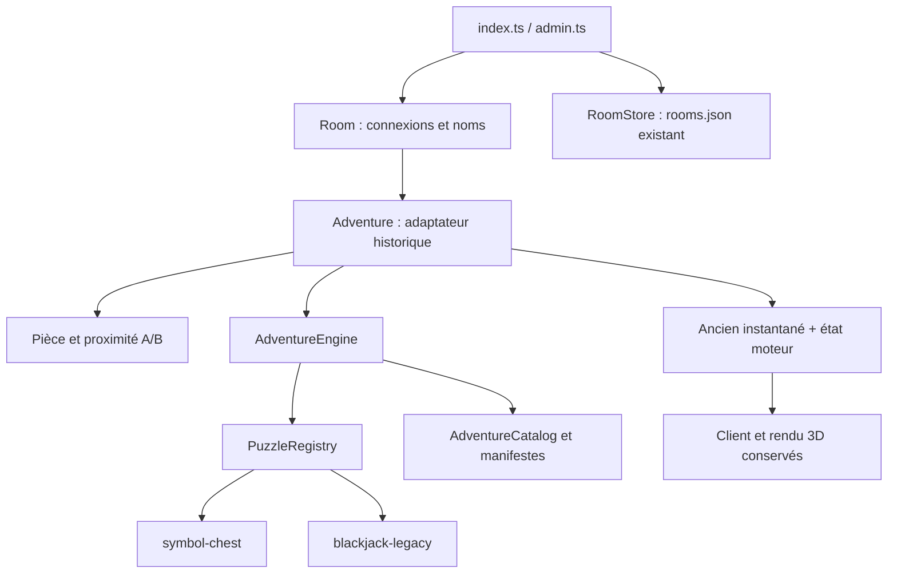

# Fondations modulaires — Phase 1

État local du 18 novembre 2026. Branche `feat/modular-adventures-phase1`. Aucune publication ni modification de version HAOS ; Phase 2 soumise à validation.

## Cartographie avant modification

Ce document conserve les décisions de la Phase 1. La Phase 2 a ensuite été autorisée : consulter [le blackjack hybride](blackjack-hybrid.md) pour les extensions `PuzzleContext`, `maintain` et `earnedRewards`, le manifeste 0.2.0 et la table 3D. Les mentions de fonctionnalités différées ci-dessous décrivent la première tranche.

- [index.ts](../../server/src/index.ts) assure HTTP/WebSocket, contrôle d’origine, quatre connexions, diagnostics et diffusion. Il envoyait les commandes à `Room.adventure`.
- [room.ts](../../server/src/room.ts) possède joueurs, révision de démo, modèle actif et instance `Adventure`.
- [adventure.ts](../../server/src/adventure.ts) réunissait règles des symboles, blackjack à une carte, révisions, proximité et transitions.
- [admin.ts](../../server/src/admin.ts) réutilise le jeton, l’origine et les limites JSON pour préparer/démarrer/réinitialiser les énigmes et gérer les pièces.
- [scene-schema.ts](../../server/src/scene-schema.ts) décrit et valide les neuf points et le panneau ; [room-store.ts](../../server/src/room-store.ts) conserve les pièces par écriture atomique. Ces deux fichiers ne sont pas modifiés dans cette phase.
- [adventure-client.ts](../../client/src/adventure-client.ts) et [adventure-view.ts](../../client/src/adventure-view.ts) consomment l’ancien instantané. Le coffre détaillé reste dans [chest-view.ts](../../client/src/chest-view.ts), sans changement.

## Découpage obtenu



Le moteur générique ne référence ni Menthe 27, ni Three.js, ni WebSocket, ni RoomModel. Les modules ne dépendent que des contrats et validateurs purs. Les noms des participants, la narration et les récompenses du scénario appartiennent au manifeste.

## Contrats TypeScript

[puzzle-types.ts](../../server/src/engine/puzzle-types.ts) définit :

- `PuzzleModule<C,S,A>` : type/version, configuration et état validés, état initial, actions autorisées et validées, réduction sans mutation de l’état fourni, condition de réussite, indices, objets et récompenses.
- `publicState(config, state)` : projection publique du module, distincte de son état privé sauvegardable. Les deux modules actuels sont ouverts ; un test de module masqué vérifie que cette séparation fonctionne, sans implémenter le croupier du blackjack hybride.
- `PuzzleInstanceSpec` : identifiant d’instance distinct du type, version de schéma et configuration.
- `AdventureManifest` : métadonnées versionnées, joueurs, durée cible, instances, étapes, liaisons spatiales, narration et victoire.
- `AdventureStep` : union discriminée d’étape jouable et d’étape prévue. `next` prépare une structure explicite ; la validation V1 impose une chaîne linéaire sans cycle.
- `AdventureSnapshot` : aventure/version, révision, étape active, instances, réussites, inventaire commun et statut.
- `PuzzleObject` et `Transform3D` : rôles fixe/manipulable/interactif/décoratif et contrat position/rotation/échelle. Les transformations et manipulations ne sont pas appliquées au rendu en Phase 1.

[PuzzleRegistry](../../server/src/engine/puzzle-registry.ts) vérifie type/version et fait passer configuration, état et action par leurs validateurs. Chaque instance possède son état propre ; les tests utilisent deux coffres avec des ordres différents.

[AdventureEngine](../../server/src/engine/adventure-engine.ts) sélectionne une définition, prépare/démarre/arrête une partie, valide l’instance active et la révision, enchaîne les étapes, attribue chaque récompense une seule fois et produit les événements `puzzle-solved`, `reward-added`, `step-changed`. L’état public masque la configuration des modules et n’expose que les indices déjà attribués. L’attribution d’indices par l’administration viendra ultérieurement.

## Compatibilité

[adventure.ts](../../server/src/adventure.ts) reste le point d’import public. Il réexporte la façade [adventure-adapter.ts](../../server/src/adventure-adapter.ts). Ce fichier supplémentaire sépare clairement les règles pures de la sécurité spatiale et de la projection historique.

L’ancienne commande `adventure_action` reste acceptée et vise l’instance active. Les symboles, ordre par défaut, panneau mural, proximité de 1,3 m, erreurs récupérables et neuf points sont conservés. Le blackjack historique est extrait dans `blackjack-legacy`, pas transformé en blackjack hybride.

L’instantané historique conserve `running`, `revision`, `phase`, `symbols`, `blackjack`, `testMode`, `message`. Un champ `engine` ajoute l’état générique ; `pending` distingue une étape prévue d’une réussite finale. Le client reçoit cette distinction et garde le coffre ouvert, sans réécrire ses géométries. Un ancien client reste utilisable avec la démonstration classique ; recharger les pages pour les nouvelles aventures et le statut `pending`.

La nouvelle enveloppe est :

```json
{
  "type": "puzzle_action",
  "revision": 12,
  "libraryRevision": 5,
  "instanceId": "menthe-chest",
  "action": { "action": "discover_symbol", "target": "sun" },
  "position": { "x": 2, "z": 1 },
  "simulation": false
}
```

`revision` reste la révision de la façade exposée dans `adventure.revision`. La révision interne `adventure.engine.revision` appartient au contrat pur du moteur. La façade traduit entre les deux. Le serveur renvoie `puzzle_result` avec `changed` et `message`, puis l’état faisant autorité ; les anciennes réponses `adventure_result` demeurent.

La proximité, le contrôle du contour et l’autorisation de simulation restent dans la façade. Les commandes sont validées par l’instance avant mutation. Les poses déclarées ne prouvent pas la présence physique. Aucun changement du calibrage A/B et aucune ancre spatiale partagée.

Les liaisons par aventure sont déclaratives, mais le rendu historique impose encore `objectId === placementKey`. La sélection refuse une liaison nécessitant le futur moteur de rendu. Plusieurs instances successives peuvent réutiliser les mêmes points ; leur état reste indépendant. Les placements séparés par aventure et les transformations 3D seront traités en Phase 3.

## Fichiers créés et modifiés

| Responsabilité | Fichiers |
|---|---|
| Contrats et validation | [puzzle-types.ts](../../server/src/engine/puzzle-types.ts), [validation.ts](../../server/src/engine/validation.ts), [adventure-manifest.ts](../../server/src/engine/adventure-manifest.ts) |
| Registre et moteur | [puzzle-registry.ts](../../server/src/engine/puzzle-registry.ts), [adventure-engine.ts](../../server/src/engine/adventure-engine.ts) |
| Modules actuels | [symbol-chest.ts](../../server/src/puzzles/symbol-chest.ts), [blackjack-legacy.ts](../../server/src/puzzles/blackjack-legacy.ts) |
| Catalogue | [catalog.ts](../../server/src/adventures/catalog.ts), [legacy.ts](../../server/src/adventures/legacy.ts), [menthe27.ts](../../server/src/adventures/menthe27.ts) |
| Adaptation serveur | [adventure.ts](../../server/src/adventure.ts), [adventure-adapter.ts](../../server/src/adventure-adapter.ts), [room.ts](../../server/src/room.ts), [index.ts](../../server/src/index.ts), [admin.ts](../../server/src/admin.ts) |
| Administration et affichage | [admin.ts](../../client/src/admin.ts), [main.ts](../../client/src/main.ts), [adventure-client.ts](../../client/src/adventure-client.ts), [adventure-view.ts](../../client/src/adventure-view.ts) |
| Tests | [engine.test.ts](../../server/src/engine/engine.test.ts), [network.test.ts](../../server/src/network.test.ts), script de [package.json](../../server/package.json) |

Les dossiers client de rendu générique, manipulation Quest et `session-store.ts` ne sont pas créés prématurément : leur implémentation appartient aux phases suivantes.

## Risques et protections

| Risque | Protection et limite actuelle |
|---|---|
| Divergence ancien/nouvel état | Un seul état de règles par instance ; projection historique, tests existants conservés |
| Double réussite ou récompense | Révisions, instance active, état résolu et inventaire dédupliqué |
| Mélange de versions | IDs et versions de manifeste/module contrôlés ; restauration incompatible refusée |
| Progression future falsifiée | États futurs vierges, étapes précédentes réussies, inventaire et statut recalculés à la restauration |
| Perte des pièces | Aucun changement de RoomStore/schéma ; test comparant le fichier avant/après sélection |
| Faux succès Menthe 27 | Étape `planned`, statut `pending`, aucun module hybride enregistré et victoire non attribuée |
| Reconnexion | UUID de connexion toujours renouvelé ; noms attachés aux places, pas encore une identité persistante |
| Perte au redémarrage | Catalogue JSON relu, pièces persistantes ; choix d’aventure, progression et noms encore en mémoire |
| Manifeste externe incorrect | Validation au démarrage, fichier conservé et démarrage refusé ; pas de code chargé depuis JSON |

`restore()` est un contrat pur et testé d’aller-retour JSON, pas une sauvegarde automatique. Aucun fichier de session ni API d’import/export de progression n’est ajouté. En Phase 3, une enveloppe séparée devra associer pièce, placements/version, participants et instantané, puis valider l’ensemble avant écriture atomique. Il faudra aussi prévoir sauvegarde préalable et reprise après incident sans toucher à `rooms.json`.

## Vérification et étapes suivantes

Exécuter `npm run typecheck`, `npm run build`, `npm test`. Les tests de modules n’importent ni Three.js ni WebSocket ; les tests existants vérifient séparément la compatibilité et le transport. Les vérifications Chrome sont des simulations, sans essai matériel Quest.

La Phase 2 reste bloquée par validation utilisateur : trois manches, capitaine, paquet secret, cartes manipulables, aimantation et verrous. La Phase 3 apportera placements séparés, sauvegardes/restauration disque et commandes admin avancées. Videoclub, réseau franco-belge, Radio Menthe et coffre-fort final restent uniquement des idées de futurs modules.
